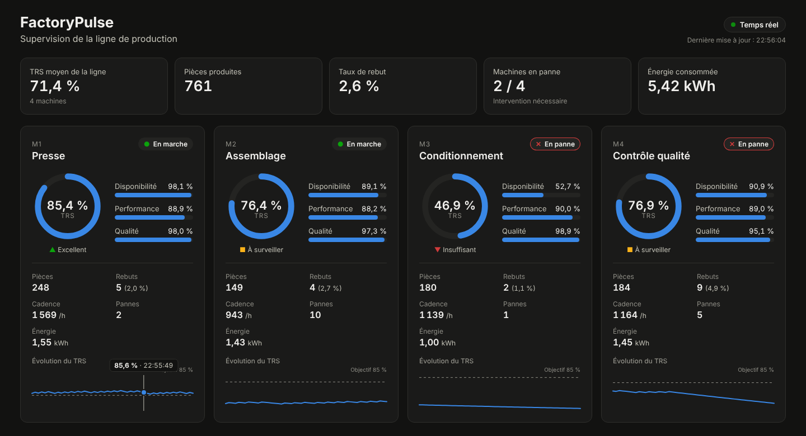

# FactoryPulse

Plateforme de **supervision en temps réel d'une ligne de production**.
Un simulateur imite des machines d'usine (production, pannes, rebuts, énergie). Les événements passent par **Kafka**. Un service **Spring Boot** calcule les indicateurs (TRS cumulé et sur 15 minutes glissantes, taux de rebut, cadence, consommation), un autre détecte les **alertes** (pannes prolongées, rebuts anormaux), et un tableau de bord **Angular** affiche le tout en direct via **WebSocket**. L'accès est protégé par **Keycloak** (OAuth2 / OpenID Connect) avec deux rôles : l'**opérateur** prend les alertes en charge et saisit les interventions de maintenance, le **responsable** consulte leur historique.



## Architecture

```
                                       ┌──► kpi-service (Spring Boot) ──► MongoDB
Simulateur (Spring Boot) ──► Kafka ────┤     calcul du TRS, rebut, cadence      │
  machines, pannes,     machine-events │                                        │ REST + WebSocket
  rebuts, énergie                      └──► alert-service (Spring Boot) ──► MongoDB   ▼
                                             pannes, rebuts anormaux ──┬──► dashboard (Angular, nginx)
                                                                       └──► Kafka : machine-alerts
```

Le kpi-service et l'alert-service lisent **le même topic** avec deux *consumer groups* différents : chacun reçoit tous les événements, sans dépendre de l'autre.

**Sécurité** : le dashboard connecte l'utilisateur avec **Keycloak** et envoie un jeton JWT à chaque appel (API REST et WebSocket). Les services vérifient ce jeton avant de répondre.

## Avancement

| Étape | Contenu | État |
|---|---|---|
| Jour 1 | Simulateur de machines + Kafka + Docker Compose | ✅ |
| Jour 2 | Service KPI : lecture Kafka, calcul du TRS, MongoDB, API REST, tests | ✅ |
| Jour 3 | WebSocket + tableau de bord Angular temps réel | ✅ |
| Jour 4 | TRS sur 15 min glissantes + microservice d'alertes + panneau Alertes | ✅ |
| Jour 5 | Sécurité : connexion et rôles avec Keycloak (OAuth2 / OpenID Connect), API et WebSocket protégés | ✅ |
| Jour 6 | Actions selon le rôle : prise en charge des alertes, interventions de maintenance, historique | ✅ |
| Jour 7 | Tests d'intégration (Testcontainers) et mise en ligne | ⏳ |

Deux niveaux d'architecture :
- **entre les services** : architecture **orientée événements**, avec des services indépendants reliés par Kafka ;
- **dans chaque service** : architecture **hexagonale** (domaine, cas d'usage, ports et adaptateurs).

Détails dans [docs/architecture.md](docs/architecture.md).

## Lancer le projet

Prérequis : **Docker Desktop**. C'est tout : Maven et Kafka tournent dans des conteneurs.

```bash
docker compose up --build
```

Puis ouvre :
- **http://localhost:4300** : le **tableau de bord** en temps réel. Connexion avec un compte de démonstration :

  | Identifiant | Mot de passe | Rôle | Peut |
  |---|---|---|---|
  | `operateur` | `operateur` | Opérateur | prendre une alerte en charge, saisir une intervention |
  | `responsable` | `responsable` | Responsable | consulter l'historique des interventions et le bilan par machine |

- **http://localhost:8180** : la console Keycloak (`admin` / `admin`) ;
- **http://localhost:8090** (Kafka UI) → *Topics* → `machine-events` → *Messages* : les événements des machines arrivent chaque seconde ;
- **http://localhost:8082/api/kpis** et **http://localhost:8083/api/alerts** : les API, qui répondent **401** sans jeton (voir [jour-5.md](docs/jour-5.md) pour les appeler avec un jeton).

Ces comptes et mots de passe servent uniquement à la démonstration en local.

### Lancer un service depuis un IDE (IntelliJ / VS Code)

```bash
docker compose up kafka kafka-ui    # Kafka seul dans Docker
```

Puis lance `SimulatorApplication` depuis l'IDE : il se connecte à `localhost:9092`.

### Lancer les tests

```bash
cd simulator   && mvn test && cd ..
cd kpi-service && mvn test && cd ..
cd alert-service && mvn test && cd ..
cd dashboard   && npm install && npm run test:ci && cd ..
```

## Exemple d'événement publié

```json
{
  "eventId": "3f6c1a2e-...",
  "machineId": "M1",
  "type": "PIECE_PRODUCED",
  "timestamp": 1767225600000,
  "good": true,
  "energyKwh": null
}
```

Types : `PIECE_PRODUCED`, `MACHINE_DOWN`, `MACHINE_UP`, `ENERGY_READING`.

## Exemple d'indicateurs (`GET /api/kpis/M1`)

```json
{
  "machineId": "M1",
  "running": true,
  "availability": 0.925,
  "performance": 0.898,
  "quality": 0.971,
  "oee": 0.807,
  "piecesProduced": 1495,
  "goodPieces": 1452,
  "rejectedPieces": 43,
  "rejectRate": 0.029,
  "throughputPerHour": 1495.0,
  "energyKwh": 13.99,
  "downCount": 13,
  "updatedAt": 1767229200000,
  "recent": {
    "windowMinutes": 15,
    "availability": 0.871,
    "performance": 0.902,
    "quality": 0.968,
    "oee": 0.760,
    "piecesProduced": 352,
    "rejectedPieces": 11
  }
}
```
Ici, après une heure de simulation : **TRS cumulé de 80,7 %** (disponibilité 92,5 % × performance 89,8 % × qualité 97,1 %). Sur les 15 dernières minutes, une panne récente fait descendre le TRS à 76,0 %.

## Exemple d'alerte (`GET /api/alerts`)

```json
{
  "id": "M3-DOWNTIME-1767229140000",
  "machineId": "M3",
  "type": "DOWNTIME",
  "severity": "CRITICAL",
  "message": "M3 en panne depuis plus de 30 s",
  "raisedAt": 1767229140000,
  "updatedAt": 1767229170000,
  "resolvedAt": null
}
```
Règles : une panne lève une alerte, qui devient **critique** au-delà de 30 s et se résout à la remise en marche ; un taux de rebut supérieur à 10 % sur les 50 dernières pièces lève une alerte, résolue sous 4 %.

## Stack

Java 21 · Spring Boot 3 · Spring Kafka · Apache Kafka (KRaft) · MongoDB · Spring Data · API REST · WebSocket (STOMP) · Spring Security · OAuth2 / OpenID Connect · JWT · Keycloak · Angular 19 (signals, Reactive Forms) · TypeScript · nginx · Docker Compose · JUnit 5 · Jasmine/Karma · GitHub Actions
*(à venir : Testcontainers)*

## Documentation

- [Architecture : services et architecture hexagonale](docs/architecture.md)
- [Jour 1 : le simulateur et Kafka expliqués](docs/jour-1.md)
- [Jour 2 : le kpi-service et le calcul du TRS](docs/jour-2.md)
- [Jour 3 : le tableau de bord temps réel (WebSocket + Angular)](docs/jour-3.md)
- [Jour 4 : TRS sur 15 minutes et microservice d'alertes](docs/jour-4.md)
- [Jour 5 : sécurité avec Keycloak (OAuth2, JWT, rôles)](docs/jour-5.md)
- [Jour 6 : actions selon le rôle (alertes, interventions)](docs/jour-6.md)
