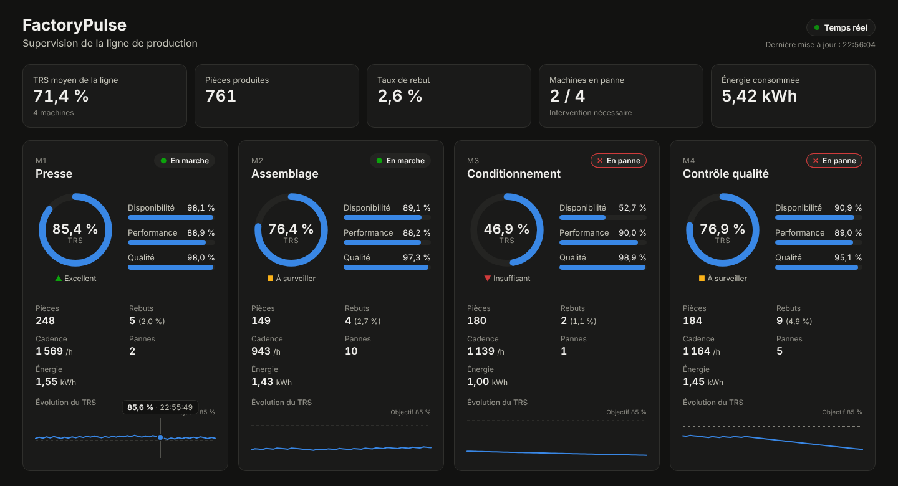

# Jour 3 : le tableau de bord temps réel (WebSocket + Angular)



## Ce qu'on a construit

1. **Côté kpi-service** : à chaque nouvel événement, les indicateurs recalculés sont **poussés** vers les navigateurs connectés, par **WebSocket** (protocole **STOMP**), sur la destination `/topic/kpis`.
2. **Un troisième microservice, `dashboard`** : une application **Angular** qui affiche les indicateurs en direct, sans recharger la page.

```
simulator ──► Kafka ──► kpi-service ──► MongoDB
                           │
                           ├── GET /api/kpis ─────────┐  (chargement initial)
                           └── WebSocket /topic/kpis ─┤  (mises à jour en direct)
                                                      ▼
                                             dashboard (Angular)
```

## REST ou WebSocket : pourquoi les deux ?

| | REST (`GET /api/kpis`) | WebSocket (`/topic/kpis`) |
|---|---|---|
| Qui parle en premier ? | Le navigateur demande | Le serveur envoie quand il veut |
| Connexion | Une requête, une réponse, puis fermée | Reste ouverte |
| Usage ici | Charger l'état actuel à l'ouverture de la page | Recevoir chaque mise à jour, en direct |

Sans WebSocket, il faudrait redemander les indicateurs toutes les secondes (*polling*) : beaucoup de requêtes inutiles, et toujours un peu de retard. Avec WebSocket, le serveur **pousse** la donnée dès qu'elle change.

## Côté kpi-service : un nouveau port de sortie

On suit la même architecture hexagonale :

| Fichier | Rôle |
|---|---|
| `application/port/out/KpiUpdatePublisher` | Port : « prévenir l'extérieur qu'une machine a changé », sans savoir comment |
| `adapter/out/websocket/StompKpiUpdatePublisher` | Adaptateur : publie sur `/topic/kpis` avec `SimpMessagingTemplate` |
| `config/WebSocketConfig` | Ouvre le point de connexion `/ws` et active le relais de messages STOMP |
| `ProcessMachineEventUseCase` | Après la sauvegarde, appelle `publisher.publish(snapshot)` |

Le cas d'usage ne connaît toujours ni Spring, ni WebSocket : dans les tests, un faux publisher garde les mises à jour dans une liste.

## Côté tableau de bord (Angular)

| Fichier | Rôle |
|---|---|
| `core/kpi-store.service.ts` | Charge l'état initial (REST), s'abonne au WebSocket, garde l'état dans des *signals* |
| `core/kpi-state.ts` | Logique pure : intégrer une mise à jour, garder l'historique, calculer les totaux de la ligne (testée) |
| `components/machine-card` | La carte d'une machine : état, jauge, composantes du TRS, compteurs, évolution |
| `components/oee-gauge` | La jauge circulaire du TRS (SVG) |
| `components/sparkline` | La courbe d'évolution du TRS, avec infobulle au survol (SVG) |
| `components/stat-tile` | Les chiffres clés de la ligne en haut de page |

**Signals** : l'état est stocké dans des `signal()` Angular. Quand une mise à jour arrive, seul ce qui en dépend se redessine. Les totaux de la ligne (`summary`) sont des `computed()`, recalculés automatiquement.

**Reconnexion** : si le kpi-service redémarre, le client STOMP se reconnecte tout seul toutes les 3 secondes. L'indicateur en haut à droite passe de « Temps réel » à « Déconnecté – reconnexion… ».

**Lisibilité** : l'état d'une machine et le niveau de TRS sont toujours donnés par une **icône et un libellé**, pas seulement par une couleur.

## Comment le navigateur atteint le kpi-service

Le tableau de bord appelle `/api` et `/ws` **sur sa propre adresse**. Un proxy redirige ces appels vers le kpi-service :
- en développement (`ng serve`), `proxy.conf.json` ;
- dans Docker, **nginx** (`dashboard/nginx.conf`).

Le navigateur ne parle donc qu'à une seule adresse : pas de problème de CORS.

## Lancer

```bash
docker compose up -d --build
```
Puis ouvrir **http://localhost:4300**.

En développement, avec rechargement automatique du code Angular :
```bash
docker compose up -d kafka mongo simulator kpi-service
cd dashboard && npm install && npx ng serve     # http://localhost:4300
```
